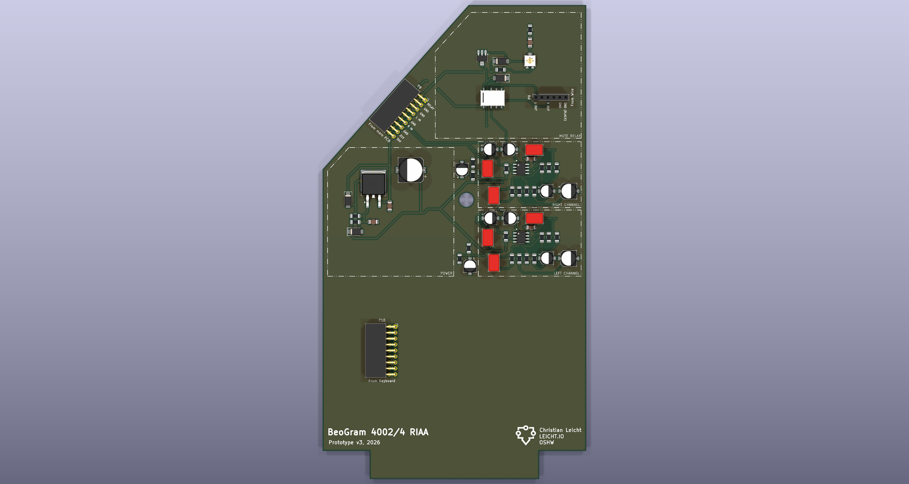

# BeoGram 4002 RIAA Preamp

[](https://github.com/leicht-io/BeoGram-4002-RIAA/actions/workflows/kicad.yml)
[](./LICENSE)
[](./LICENSE-DOCS)

An open-source RIAA phono preamplifier board for the Bang & Olufsen **BeoGram 4002 / 4004** turntable, designed in KiCad.



| | |
|---|---|
| **Status** | Prototype v3 (SMD) – designed, not built yet. v2 was manufactured and tested working. |
| **Tool** | KiCad 10 |
| **Board** | 2-layer, 1.6 mm, ~112 × 202 mm |
| **Hardware licence** | [CERN-OHL-S v2](./LICENSE) |
| **Docs licence** | [CC BY-SA 4.0](./LICENSE-DOCS) |

> This project is community driven. Build reports, measurements and design improvements are very welcome – see [CONTRIBUTING.md](./CONTRIBUTING.md).
> Questions and build help: [Discussions](https://github.com/leicht-io/BeoGram-4002-RIAA/discussions).

---

## Contents

- [Technical overview](#technical-overview)
- [Connectors](#connectors)
- [Getting the fabrication files](#getting-the-fabrication-files)
- [Building one](#building-one)
- [Known issues and roadmap](#known-issues-and-roadmap)
- [Repository layout](#repository-layout)
- [Contributing](#contributing)
- [Safety and disclaimer](#safety-and-disclaimer)
- [License](#license)

---

## Technical overview

A dual-stage active/passive RIAA equalizer per channel, based on the classic LM833 application topology but using the **OPA2134** for lower distortion. Full details are in [docs/design-notes.md](./docs/design-notes.md).

- **Stage 1 (U5A / U6A):** non-inverting gain stage that sets the 3180 µs / 318 µs part of the RIAA curve.
- **75 µs network:** passive RC between the stages.
- **Stage 2 (U5B / U6B):** flat gain of about 4.75×.
- **Output:** 100 Ω (R113 / R213) in series with each output keeps cable capacitance away from the op-amp, and limits the current when the mute relay shorts the output.
- **Gain:** about 38 dB at 1 kHz (simulated, not yet measured). B&O's MMC cartridges give about 2.5–3 mV, so the output is roughly 200–250 mV.
- **Power:** an LM317 makes about 20.8 V from the turntable's 30 V rail, which is unregulated (B&O bridge rectifier and 4000 µF). The op-amps run from this single supply.
- **Bias:** each channel has a filtered half-supply reference (`VREF_L` / `VREF_R`). Stage 1 is biased from it, so supply ripple is not amplified, and stage 2 is DC-coupled to stage 1. R103/R203 (47 k) also set the 47 kΩ cartridge load.
- **Grounding:** each pickup return runs next to its signal trace and joins GND at one point, at the input stage (net ties NT1/NT2).
- **Mute relay:** an Omron G6K-2 shorts both outputs to ground until the turntable's `RELAY ON` signal has been present for a while. The delay is set with RV1, and the board mutes instantly when the signal drops. Q1 is a Darlington (BCV49), as on the original B&O board.
- **Capacitors:** ceramic wherever a ceramic works. Six electrolytics remain (C103/C203, C106/C206, C108/C208), where a ceramic would pick up vibration or add distortion (see the [design notes](./docs/design-notes.md#capacitors)).

### Simulated response


Simulated with nominal part values, an ideal source and a 47 kΩ amplifier input. It has not been measured yet.

| Frequency | v3 deviation from RIAA | v2 deviation from RIAA |
|---|---|---|
| 20 Hz | −0.63 dB | −0.85 dB |
| 50 Hz | −0.08 dB | −0.23 dB |
| 100 Hz | +0.03 dB | −0.12 dB |
| 1 kHz | 0 (reference) | 0 (reference) |
| 10 kHz | −0.02 dB | +0.70 dB |
| 20 kHz | −0.03 dB | +0.73 dB |

The roll-off below 50 Hz comes from the coupling capacitors. Real boards also vary with the 5 % tolerance of the RIAA film capacitors. To regenerate the chart after changing values, edit them in `scripts/riaa_response.py` and run `python3 scripts/riaa_response.py images/riaa-response.svg`.

## Connectors

The board takes the place of B&O's PCB 8, the muting module (8005014 in the 4002, 8005022 with remote control in the 4004). Pin *n* of the original 9-pin P8 and P10 is pins 2*n*−1 and 2*n* here.

**P8 – From main PCB** (2×9, 2.54 mm)

| Pin | Signal |
|---|---|
| 1, 2 | RELAY ON |
| 3, 4 | GND (main board) |
| 5, 6 | Pickup cable shields (GND) |
| 7, 8 | L IN (pickup) |
| 9, 10 | L pickup return (joins GND only at NT1) |
| 11, 12 | R IN (pickup) |
| 13, 14 | R pickup return (joins GND only at NT2) |
| 15, 16 | 21 V (relay supply) |
| 17, 18 | 30 V (preamp supply) |

**P10 – From Keyboard** (2×9, 2.54 mm). Power only; the other pins are not connected. Like the original module, the board passes 30 V, 21 V and GND from P8 through to the keyboard.

| Pin | Signal |
|---|---|
| 3, 4 | 30 V |
| 11, 12 | 21 V |
| 13, 14 | GND |

**P9 – Output** (1×6, 2.54 mm). Same pin layout as the original P9, so the turntable's own output harness fits.

| Pin | Signal |
|---|---|
| 1 | L OUT (DIN pin 3) |
| 3 | R OUT (DIN pin 5) |
| 5 | GND, signal ground (DIN pin 2) |
| 6 | GND, chassis |
| 2, 4 | Not connected (Beomaster 2400 remote lines on a 4004, see below) |

**BeoGram 4004:** the 4004's PCB 8 (8005022) also holds the remote-control circuit for a Beomaster 2400 (start, pause and stop from the PHONO and STAND BY keys). This board doesn't have it:

- P10 carries the same 30 V, 21 V and GND as on the 4004 board, so the turntable's own keys work. The remote-control pins of P10 are left open, so the Beomaster 2400 remote can't start, pause or stop the turntable.
- The 4004's P9 harness has two extra wires on pins 2 and 4 (DIN pins 6 and 7, the Beomaster's remote signals). Those pins aren't connected on this board, so the harness can be plugged in as it is.

## Getting the fabrication files

Gerbers and other fabrication files are **not committed** to the repository. CI generates them from the KiCad sources on every push, so they always match the design:

- **Releases:** every tagged version (`v*`) has a [GitHub release](https://github.com/leicht-io/BeoGram-4002-RIAA/releases) with the gerber zip, a schematic PDF, the BOMs, the pick-and-place files and renders.
- **Latest `main` / any PR:** open the latest [KiCad workflow run](https://github.com/leicht-io/BeoGram-4002-RIAA/actions/workflows/kicad.yml) and download the `fabrication` artifact (you must be logged in to GitHub).
- **Locally:** in KiCad, *File → Fabrication Outputs*, or run the `kicad-cli` commands from [`.github/workflows/kicad.yml`](./.github/workflows/kicad.yml).

The gerbers of the first (v1) prototype are no longer in the tree but remain in the git history.

The CI produces these BOMs and pick-and-place (CPL) files:

| File | Contents |
|---|---|
| `RIAA-bom-full.csv` | Every part, with manufacturer, manufacturer part number (MPN) and LCSC number. The `Assembly` column says whether a part is assembled by JLCPCB or soldered by hand. |
| `RIAA-bom-jlcpcb.csv` + `RIAA-cpl-jlcpcb.csv` | Upload-ready files for JLCPCB SMT assembly (parts from LCSC; film capacitors excluded). |
| `RIAA-bom-pcbway.csv` + `RIAA-cpl-pcbway.csv` | Upload-ready files for PCBWay turnkey assembly. The BOM lists every part, including the film capacitors and connectors, by manufacturer and MPN, with the LCSC number as distributor part number. The CPL lists the surface-mount parts. |

Every part in the schematic has `Manufacturer` and `MPN` fields; parts JLCPCB can place also have an `LCSC PN` field.

## Building one

1. Order the board with assembly from one of the two fabs:
   - **JLCPCB:** SMT assembly with the gerber zip, `RIAA-bom-jlcpcb.csv` and `RIAA-cpl-jlcpcb.csv`. The film capacitors are not included (step 2).
   - **PCBWay:** turnkey assembly with the gerber zip, `RIAA-bom-pcbway.csv` and `RIAA-cpl-pcbway.csv`. PCBWay sources every part, including the through-hole film capacitors and connectors, so step 2 is not needed.

   Check the part rotations and the polarity of the diodes and electrolytic capacitors in the fab's preview before confirming. Stock of the 0.1 % resistors in the RIAA network is low at times. A 1 % part of the same value is fine if one runs out.
2. For a JLCPCB board, hand-solder the parts marked `Hand` in `RIAA-bom-full.csv`: the film capacitors C101, C102, C105 and C201, C202, C205. C102/C202 and C105/C205 set the RIAA time constants, so tight-tolerance or matched parts give the most accurate curve.
3. Set RV1 for the unmute delay you want (about 1 s to 10 s).
4. Install it in the turntable. *An illustrated installation guide is still missing – contributions are very welcome.*

Please post a **Build report** issue when you have built one, whether it worked or not.

## Known issues and roadmap

- [ ] **v3 has not been built yet.** The hum, bias and mute-relay fixes are simulated and the board passes DRC/ERC, but they still need to be confirmed on a real board (see [CHANGELOG.md](./CHANGELOG.md)).
- [ ] **Hum on some turntables (v2).** If a v3 board still hums, check the 30 V rail, P10, and whether the turntable joins the pickup returns to ground somewhere else (see the [design notes](./docs/design-notes.md#hum-and-ground-loops)).
- [ ] **No measurements yet:** RIAA deviation, noise and THD are still missing.
- [ ] **No installation guide or photos yet.**
- [ ] **No BeoGram 4004 remote control:** start, pause and stop from a Beomaster 2400 are not supported (see [Connectors](#connectors)).

## Repository layout

```
RIAA.kicad_pro / .kicad_sch / .kicad_pcb   KiCad project
parts/                                     Project-local footprints (OPA2134 D8)
3d-parts/                                  STL files for the 3D-printed board guides
docs/                                      Design notes
images/                                    Renders and photos
scripts/make_bom.py                        Builds the full, JLCPCB and PCBWay BOMs and CPL files (used by CI)
scripts/riaa_response.py                   Simulates the RIAA response and draws images/riaa-response.svg
.github/                                   CI workflow, issue and PR templates
```

## Contributing

See [CONTRIBUTING.md](./CONTRIBUTING.md). In short: open an issue or discussion first for design changes, keep each PR focused, and include screenshots of what you changed in the schematic or PCB.

## Safety and disclaimer

This board connects to the turntable's internal 30 V supply. Vintage equipment can be damaged by wiring mistakes. Everything here is provided **as is, without any warranty** (see the licence), and you build and install it at your own risk.

Bang & Olufsen, BeoGram and related names are trademarks of their owners. This project is not affiliated with or endorsed by Bang & Olufsen.

## License

- **Hardware design files** (KiCad, STL): [CERN Open Hardware Licence v2 – Strongly Reciprocal](./LICENSE) (CERN-OHL-S-2.0)
- **Documentation and images:** [Creative Commons Attribution-ShareAlike 4.0](./LICENSE-DOCS) (CC-BY-SA-4.0)
- **Scripts** (`scripts/`): GPL-3.0-or-later

## Author

Christian Leicht – [leicht.io](https://github.com/leicht-io)
